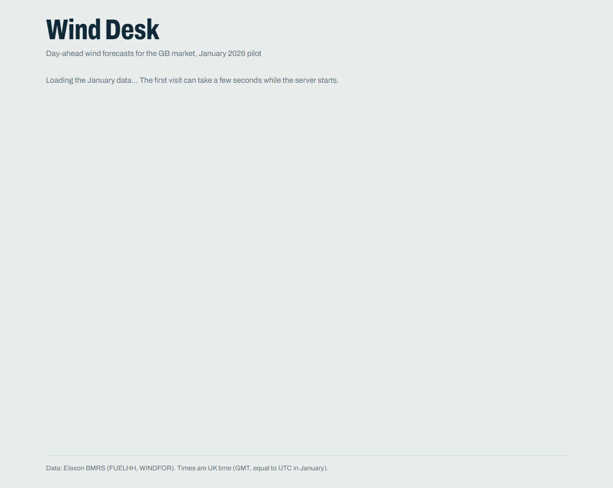
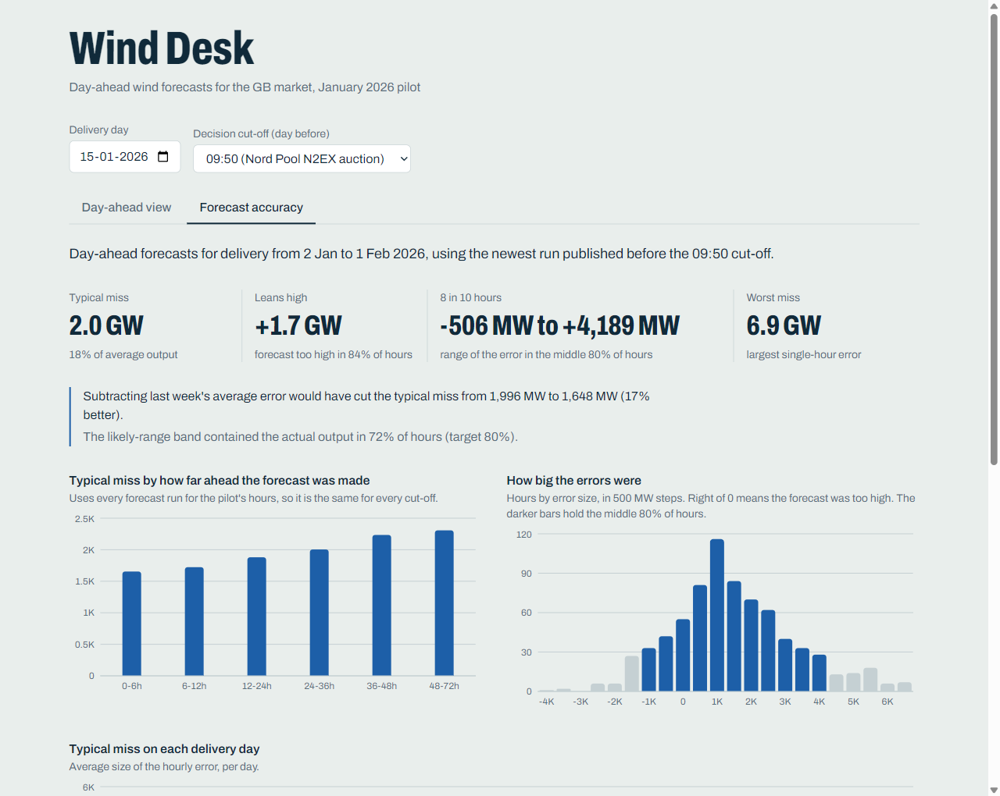

# Wind Desk

The wind forecast a GB day-ahead power buyer could actually have used, and how far off it turned out to be.

**Live app: https://ptihyl.vercel.app**. The first visit can take a few seconds while the server starts.

Wind Desk is a pilot for an energy supplier's team that buys electricity on the GB day-ahead market. They place orders the
day before delivery, so they plan around whatever wind forecast exists at that moment. The app has two views:

- **Day-ahead view.** Pick a delivery day and the time the order has to go in. You see three things for each hour:
  - the forecast that was available at that time
  - a likely range built from the previous week's errors
  - what the wind actually produced
- **Forecast accuracy.** Covers the whole pilot:
  - how wrong those forecasts were
  - how accuracy changes with how far ahead they were made
  - how much a simple correction would have helped




## Key findings

These figures use the 09:50 cut-off (the Nord Pool auction) and cover delivery days 2 Jan to 1 Feb 2026.

- The forecast the team could use missed by **about 2 GW per hour on average**: a mean absolute error of 1,996 MW, which is
  18% of average wind output.
- It **leaned high**: on average 1,728 MW above what was delivered, and too high in 84% of hours.
- In 8 hours out of 10 the error was between −506 and +4,189 MW. The worst single hour was off by 6,857 MW.
- Forecasts made closer to delivery are better: a typical miss of 1,654 MW when made 0–6 h ahead, against 2,307 MW when made
  48–72 h ahead. The lean high shows up at every lead time.
- Subtracting the previous week's average error would have cut the typical miss to **1,648 MW, 17% better**. That uses only
  information the team had at the time.

## Run it

**With Docker** (the same image that runs in production):

```bash
docker compose up --build        # then open http://localhost:8000
```

**For development** (two terminals):

```bash
cd backend  && uv sync && uv run uvicorn app.main:app --reload --port 8000
cd frontend && npm install && npm run dev        # http://localhost:5173, proxies /api to :8000
```

**Refresh the data snapshot** from Elexon (the app itself never calls Elexon):

```bash
cd backend && uv run python -m app.ingest
```

Requirements: Docker; or [uv](https://docs.astral.sh/uv/) (it installs Python 3.13 itself) and Node 24.

## How it works

```
Elexon BMRS API ──► backend/app/ingest.py ──► backend/data/*.json (committed snapshot)
                                                         │
                      FastAPI: /api/meta  /api/day  /api/accuracy
                                                         │
                      React app, served by the same container ──► one Docker image ──► Vercel
```

- **Backend (Python, FastAPI).** It loads the snapshot once and computes everything in plain Python. There are about 26,000
  rows, so pandas isn't needed.
- **Frontend (React, TypeScript, Vite, Tailwind, Recharts).** It keeps the chosen day, cut-off and tab in the URL, so any
  view can be shared as a link.
- **One Docker image.** A Node stage builds the frontend; a Python stage serves both the API and the built files.

## Method and assumptions

- **Data.** Elexon national wind only: FUELHH (`fuelType=WIND`) for actual output, WINDFOR for forecasts. Nothing else.
- **Scope.** "Decisions made in January 2026" means delivery days 2 Jan to 1 Feb 2026, because each decision is made the day
  before delivery. The snapshot also holds late-December data, so every January decision has a full week of error history.
- **Decision cut-offs** (UK time, on the day before delivery):
  - 09:20, the EPEX hourly auction (10:20 CET on [EPEX SPOT](https://www.epexspot.com/en))
  - 09:50, the Nord Pool N2EX auction, the default
    ([Nord Pool](https://support.nordpoolgroup.com/support/solutions/articles/8000088463-about-the-day-ahead-gb-auction))
  - 15:30, the EPEX half-hourly auction
    ([EPEX trading brochure](https://www.epexspot.com/sites/default/files/download_center_files/Trading%20Brochure.pdf))
  - or any custom time
- **The forecast that counts.** For each hour, it is the newest WINDFOR value published strictly before the cut-off.
  WINDFOR also republishes values for hours that have already passed; those are ignored.
- **Matching.** WINDFOR is hourly and FUELHH is half-hourly. Each forecast is compared with the actual for the half-hour that
  starts on the hour (equal `startTime`).
- **Measures.**
  - Error = forecast − actual.
  - Typical miss is the mean absolute error.
  - Percentiles use the nearest-rank rule.
- **No look-ahead.** The likely range for day D is the 10th–90th percentile of errors, and the bias adjustment is their mean.
  Both use only errors from delivery days D−8 to D−2, the days already complete when the order goes in on D−1.
- **Times.** All data is in UTC. UK time equals UTC in January, and the app always displays it, whatever the viewer's
  timezone.

## Files and directories

| Path | What it is |
|---|---|
| `backend/app/config.py` | Constants: date windows, cut-off presets, lead-time buckets |
| `backend/app/ingest.py` | Downloads FUELHH and WINDFOR from Elexon into `backend/data/` |
| `backend/app/data.py` | Loads the snapshot into typed objects |
| `backend/app/forecasts.py` | Picks the forecast available at the cut-off |
| `backend/app/metrics.py` | Error measures: percentile, summary, histogram |
| `backend/app/views.py` | Builds the day and accuracy payloads, including the likely range and bias adjustment |
| `backend/app/schemas.py` | API response shapes |
| `backend/app/main.py` | API routes, input validation, serving the built frontend |
| `backend/data/` | The committed data snapshot (about 2.3 MB) |
| `backend/tests/` | Backend tests, including tests that pin every headline number |
| `frontend/src/api.ts` | Typed API client |
| `frontend/src/format.ts` | Number and time formatting, always in UK time |
| `frontend/src/urlState.ts` | Keeps the view state in the URL |
| `frontend/src/hooks/useApi.ts` | Data loading that drops stale responses |
| `frontend/src/components/` | The two views, charts, controls and readouts |
| `frontend/src/test/` | Test setup and fixtures captured from the real API |
| `research/explore.py` | A standalone script (standard library only) that reproduces the analysis independently |
| `Dockerfile.vercel` | The one Docker image, used locally and on Vercel |
| `docker-compose.yml` | Runs the image locally on port 8000 |
| `vercel.json` | Tells Vercel to build the container |
| `.github/workflows/ci.yml` | CI: lint, tests and builds on every push |

## Tests and CI

- **Backend:** `cd backend && uv run pytest -q` runs 32 tests, then `uv run ruff check .` lints.
- **Frontend:** `cd frontend && npm test -- --run` runs 13 tests. They always run in the Asia/Kolkata timezone, so any
  local-time bug fails loudly. Then `npm run lint` and `npm run build`.
- **GitHub Actions** runs all of the above and builds the Docker image on every push.

## Deployment

Vercel runs the same image as `docker compose`, built from `Dockerfile.vercel`. `vercel.json` sets `"framework": "container"`,
because Vercel only auto-detects a Dockerfile on a project's first deployment. To deploy, run `vercel deploy --prod`.

## AI tools used

This project was built with the help of **Claude Code**, Anthropic's AI coding assistant. It was used for:
- researching the data and the GB day-ahead market rules
- planning
- writing code and tests
- reviewing

Every number the app shows is pinned by automated tests. `research/explore.py` independently reproduces the headline accuracy
figures. Two differences are expected:
- Its bias-adjusted miss is 1,657 MW rather than 1,648 MW, because its error history starts on 30 Dec instead of 25 Dec.
- It does not compute band coverage.
